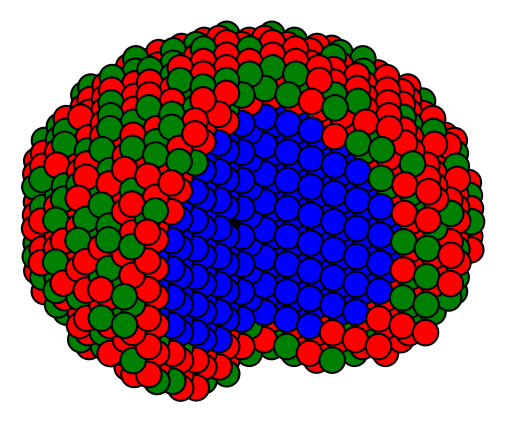
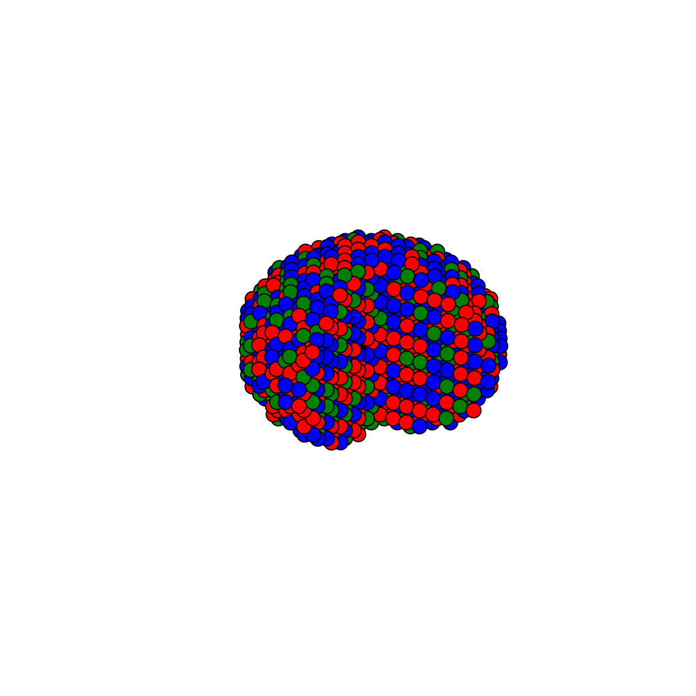
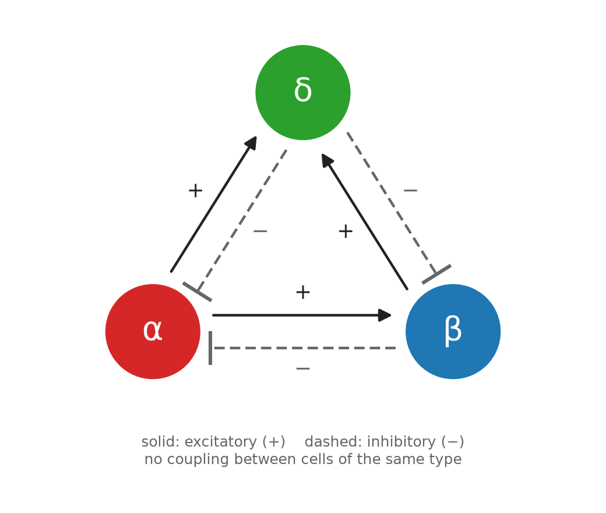
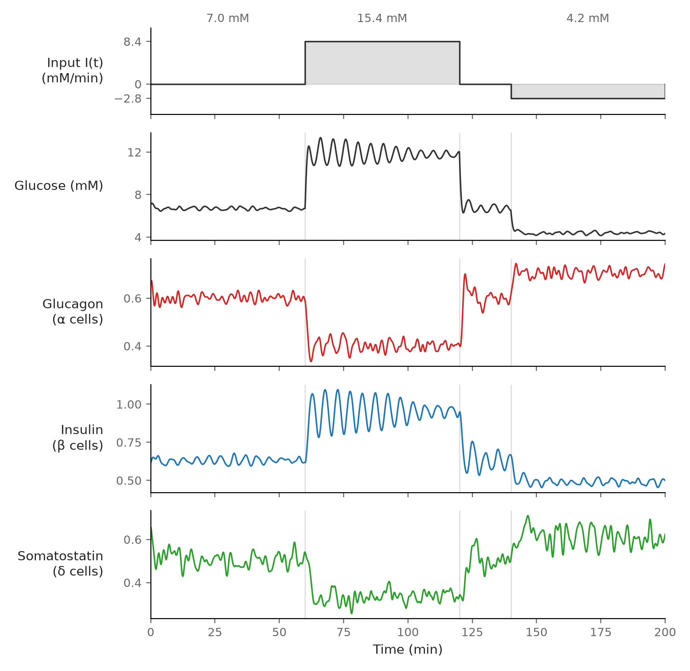

# islet-architecture-insulin

Simulation of a single pancreatic islet of Langerhans as a network of coupled
endocrine-cell oscillators, used to study how the spatial arrangement of α, β and δ cells
affects insulin secretion.

<p align="center">
  
  &nbsp;&nbsp;
  
  <br>
  <em>3D islet models on a hexagonal close-packed lattice (cut view).
  Left: Core — β cells (blue) in the centre, α (red) and δ (green) cells outside.
  Right: Mix — all cell types randomly arranged.</em>
</p>

## Model

The model and the islet structure follow the work of **Junghyo Jo** and colleagues:

- **Oscillator model.** Each α, β and δ cell is a glucose-modulated oscillator, and neighbouring cells interact through a local counter-regulatory network.
  > Park D-H, Song T, Hoang D-T, Xu J, Jo J. A local counter-regulatory motif modulates the global phase of hormonal oscillations. *Scientific Reports* 7, 1602 (2017). https://doi.org/10.1038/s41598-017-01806-0

- **Islet structure.** Cells occupy the sites of a 3D hexagonal close-packed lattice inside a sphere.
  > Hoang D-T, Matsunari H, Nagaya M, Nagashima H, Millis JM, Witkowski P, Periwal V, Hara M, Jo J. A conserved rule for pancreatic islet organization. *PLOS ONE* 9(10), e110384 (2014). https://doi.org/10.1371/journal.pone.0110384

- **Cell size.** Islet size is converted to diameter with the mean endocrine-cell radius of 5.1 µm.
  > Jo J, Choi MY, Koh D-S. Size distribution of mouse Langerhans islets. *Biophysical Journal* 93(8), 2655–2666 (2007).

The original simulation code by Taegeun Song is kept unchanged in [`original/`](original/).

<p align="center">
  
  <br>
  <em>Interactions between neighbouring cells in the model.</em>
</p>

<p align="center">
  
  <br>
  <em>Example run: external glucose input I(t), blood glucose and the hormone output per cell (glucagon, insulin, somatostatin)
  of one islet while the glucose input is changed (7.0 → 15.4 → 4.2 mM).</em>
</p>

## Repository

```
fortran/     islet simulation (Core and Mix structures)
structure/   3D structure generator, structure files (.pdb), 3D drawing
scripts/     batch runs, data extraction, figures, random-forest analysis
data/        processed simulation results
results/     figures
original/    original code as received
docs/        detailed reproduction guide
```

## Usage

Requirements: `gfortran`, Python 3 with `numpy`, `pandas`, `scikit-learn`, `matplotlib`.

```bash
# build 3D islet structures and draw one
structure/make_structures.sh
python structure/draw_islet_3d.py structure/pdb/core/config_ini_3D4,4.pdb -o islet.png

# run the islet simulation (short test, ~2 min; drop SIZES/NTS for a full batch)
SIZES=1 NTS=1 scripts/run_batch.sh 0.6 test

# figures and analysis from the processed data
python scripts/make_fig2.py
python scripts/rf_analysis.py
python scripts/make_fig3.py
```

See [`docs/REPRODUCE.md`](docs/REPRODUCE.md) for all options.

## Citation

If you use this code, please cite the model papers above. A citation for this work will be added on publication.

## License

To be added.
