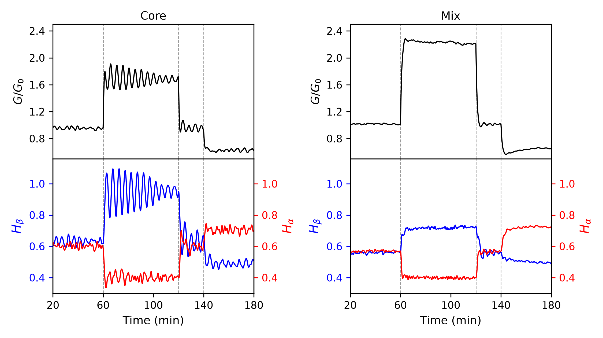
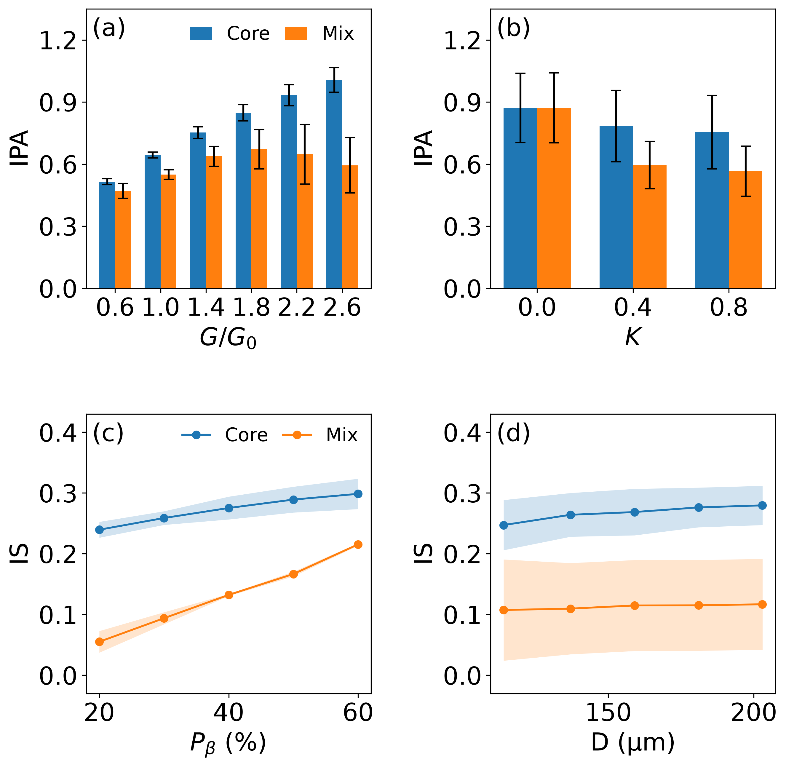
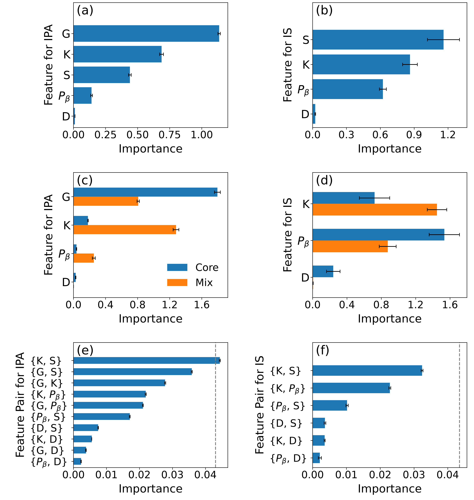

# Islet architecture and insulin output

Simulation and analysis code for the manuscript
**"Intercellular coupling generates structure-dependent partitioning of insulin output and glucose responsiveness in a pancreatic islet model"**
(Yun Gyeom Kim, Junghyo Jo, Taegeun Song; in preparation).

We ask how the spatial arrangement of α, β and δ cells in a single pancreatic islet
(**Core**: β cells in the centre; **Mix**: random arrangement), together with β-cell fraction,
islet size and intercellular coupling, shapes mean insulin output and glucose responsiveness.

## Model origin

The models used here were proposed in earlier work; this repository applies them to a new question.

- **Oscillator model of islet cells** — each endocrine cell is a glucose-modulated oscillator coupled to its neighbours through a local counter-regulatory network.
  Park DH, Song T, Hoang DT, Xu J, Jo J. *A local counter-regulatory motif modulates the global phase of hormonal oscillations.* Sci Rep. 2017;7:1602. doi:[10.1038/s41598-017-01806-0](https://doi.org/10.1038/s41598-017-01806-0)
- **3D islet structure on a hexagonal close-packed lattice** —
  Hoang DT, Matsunari H, Nagaya M, Nagashima H, Millis JM, Witkowski P, Periwal V, Hara M, Jo J. *A conserved rule for pancreatic islet organization.* PLOS ONE. 2014;9(10):e110384. doi:[10.1371/journal.pone.0110384](https://doi.org/10.1371/journal.pone.0110384)
- **Endocrine cell size** (R = 5.1 µm, used to label islet diameter) —
  Jo J, Choi MY, Koh DS. *Size distribution of mouse Langerhans islets.* Biophys J. 2007;93(8):2655–2666.

The original code received from T. Song is kept unchanged in [`original/`](original/), with a list of what we changed and why.

## Overview

| | |
|:---:|:---:|
|  |  |
| Core structure (α red, β blue, δ green; cut view) | Mix structure |


*Glucose (top) and hormone output (bottom) under the three-epoch protocol (7.0 → 15.4 → 4.2 mM) for a Core and a Mix islet.*


*Insulin production amount (IPA) and insulin susceptibility (IS) for Core and Mix islets.*


*Random-forest feature importance and pairwise interactions (dashed line: twice the noise floor).*

**Main results (model):** Core islets show higher IPA and IS than Mix islets; Mix IPA peaks at intermediate glucose and then declines;
the difference between structures disappears without coupling (K = 0); only the K × S interaction exceeds twice the noise floor.

## Repository

| Folder | Content |
|---|---|
| `fortran/` | Simulation code (Core, Mix) used for the paper, commented |
| `structure/` | 3D structure generator, structure files (pdb), 3D drawing and structure checks |
| `scripts/` | Batch run, IPA extraction, figures, random-forest analysis |
| `data/` | Processed results (IPA per realization, condition means, IS) |
| `results/` | Figures and analysis tables |
| `original/` | Original code as received, and the list of changes |
| `docs/REPRODUCE.md` | Step-by-step reproduction, parameters, data provenance, equivalence test |

Quick start (Python 3, numpy, pandas, scikit-learn, matplotlib):

```bash
python scripts/make_fig2.py        # Fig 2 from data/
python scripts/rf_analysis.py      # random forest (a few minutes)
python scripts/make_fig3.py        # Fig 3
```

## License and citation

TODO — license, archive DOI and citation will be added before publication.
